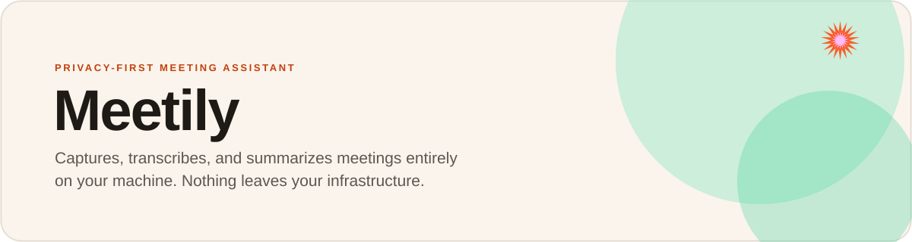

<p align="center">
  
</p>

<p align="center">
  
  
  
  <a href="https://github.com/Ntrakiyski"></a>
</p>

Meetily is a privacy-first AI meeting assistant that runs entirely on local infrastructure. It captures a meeting, transcribes it in real time, and generates a summary — without sending any audio, transcript, or recording to the cloud.

<p align="center">
  
</p>

## Why local-first

- **Privacy first.** All processing happens on your device — transcription, summarization, storage.
- **Cost-effective.** Uses open-source AI models instead of paid transcription APIs.
- **Flexible.** Works offline and supports multiple meeting platforms.
- **Customizable.** Self-host and adapt it for your own workflow.

## Features

- **Local-first:** all processing happens on the machine running the app; nothing leaves it.
- **Real-time transcription:** a live transcript as the meeting happens.
- **AI-powered summaries:** generated with your choice of language model.
- **Multi-platform:** macOS, Windows, and Linux.
- **Flexible AI provider support:** Ollama (local), Claude, Groq, OpenRouter, or any OpenAI-compatible endpoint.
- **GPU acceleration:** Metal + CoreML on macOS, CUDA (NVIDIA) or Vulkan (AMD/Intel) on Windows/Linux, enabled automatically at build time.

## Key features in action

### Local transcription

Transcribe meetings entirely on-device using **Whisper** or **Parakeet** models — no cloud required.

<p align="center">
  
</p>

### AI-powered summaries

Generate meeting summaries with your choice of AI provider — Ollama recommended, with Claude, Groq, OpenRouter, and OpenAI supported.

<p align="center">
  
</p>

### Privacy-first design

All data — transcription models, recordings, and transcripts — stays local.

<p align="center">
  
</p>

### Professional audio mixing

Captures microphone and system audio simultaneously with intelligent ducking and clipping prevention.

<p align="center">
  
</p>

## Installation

### Windows

1. Download the latest `x64-setup.exe` from [Releases](https://github.com/Zackriya-Solutions/meeting-minutes/releases/latest)
2. Run the installer

### macOS

1. Download the `.dmg` from [Releases](https://github.com/Zackriya-Solutions/meeting-minutes/releases/latest)
2. Open it and drag **Meetily** to Applications
3. Open **Meetily** from Applications

### Linux

Build from source — see [Building on Linux](docs/building_in_linux.md) and [General Build Instructions](docs/BUILDING.md).

```bash
git clone https://github.com/Zackriya-Solutions/meeting-minutes
cd meeting-minutes/frontend
pnpm install
./build-gpu.sh
```

## System architecture

Meetily is a single, self-contained application built with [Tauri](https://tauri.app/): a Rust backend handles audio capture, transcription, and storage; a Next.js frontend handles the UI. See [docs/architecture.md](docs/architecture.md).

## For developers

Building from source requires Rust and Node.js. See the [Building from Source guide](docs/BUILDING.md).

## Acknowledgments

- Code borrowed from [Whisper.cpp](https://github.com/ggerganov/whisper.cpp), [Screenpipe](https://github.com/mediar-ai/screenpipe), and [transcribe-rs](https://crates.io/crates/transcribe-rs).
- Thanks to **NVIDIA** for the **Parakeet** model, and to [istupakov](https://huggingface.co/istupakov/parakeet-tdt-0.6b-v3-onnx) for its ONNX conversion.
- Import & Enhance contributed by [Jeremi Joslin](https://github.com/jeremi), improved by [Vishnu P S](https://github.com/p-s-vishnu) and [Mohammed Safvan](https://github.com/mohammedsafvan).

## License

MIT License.

---

<p align="center"><sub>Self-hosted and operated by <a href="https://github.com/Ntrakiyski">Fractals</a></sub></p>
